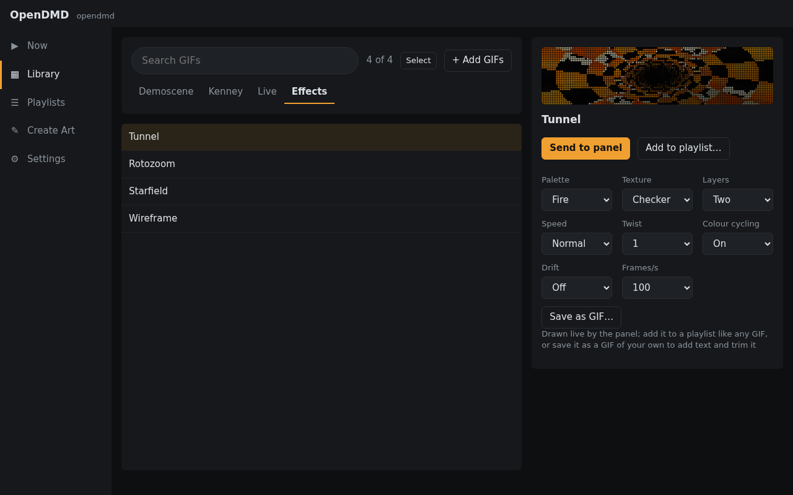

<h1 align="center"></h1>

New open firmware and a web app for the DMDoS LED dot-matrix display.

  
  

  <a href="https://opendmd.github.io/demo/"><b>Try the demo in your browser →</b></a>
  &nbsp;·&nbsp; <a href="https://opendmd.github.io/install/">Install on your display</a>
  &nbsp;·&nbsp; <a href="https://opendmd.github.io/guide/hardware.html">What you need</a>
  &nbsp;·&nbsp; <a href="https://opendmd.github.io/">Documentation</a>

<!-- site:hero -->

OpenDMD is open-source firmware and a web app for the **DMDoS display**: a 128x32 LED
dot-matrix display, two chained 64x32 HUB75 panels driven by an ESP32, that plays animated GIFs
from a microSD card, like the "DMD" in a pinball machine. DMDoS is a community project from
Spain, and **[dmdos.net](https://dmdos.net/)** is where to get the hardware, build the display
and find GIFs. OpenDMD is an alternative firmware for the same board: it plays a DMDoS card as
it is, and adds a web app to manage it.

- **The firmware** runs on the display's own ESP32 board. It plays the card and serves the web
  app over WiFi.
- **The web app** at `http://opendmd.local/` works in any browser, on a phone or a computer.
  Previews and GIF preparation run right in the browser, using the same engine as the player.
- **The simulator** plays a card in a desktop window, drawn as LEDs rather than flat pixels.

<!-- site:tiles -->

## OpenDMD and DMDoS

OpenDMD only replaces the software on the ESP32. The hardware, the build and the GIFs come
from DMDoS:

<!-- site:features -->

- **The hardware:** the parts list, with where to buy each one, is in the Hardware section of
  [dmdos.net](https://dmdos.net/). The DMDoS Board V3 is made by
  [MORTACA](https://mortaca.com). [What you need](docs/guide/hardware.md) sums it up.
- **Building it:** the Assembly section of [dmdos.net](https://dmdos.net/) walks through it
  step by step, with a photo for each.
- **A frame:** a 3D-printable frame by Janibol of
  [Retromojones](https://www.youtube.com/@retromojones) is on
  [Thingiverse](https://www.thingiverse.com/thing:6704880). The Frame section of dmdos.net has
  printed kits and wooden frames.
- **GIFs:** the DMDoS GIF pack is in the Software section of [dmdos.net](https://dmdos.net/).
  A card set up with it plays on OpenDMD as it is.

OpenDMD is an independent project, not made by or affiliated with DMDoS or MORTACA. The
original DMDoS firmware can be put back at any time from the Software section of dmdos.net.

## Install

Open the **[installer](https://opendmd.github.io/install/)** in Chrome, Edge, Opera or
Firefox on a computer, plug the
display's ESP32 board into your computer by USB, and click **Install**. When it's done, the
installer asks for your WiFi and puts the board on it; the web app is then at
`http://opendmd.local/`. (Skipped that? The player opens a WiFi network called
`OpenDMD-Setup` to set it up from instead.) [Install](docs/guide/install.md) has the details.

From source: `make fw-release && make flasher` (see [For developers](docs/developers.md)).

## What it does

<!-- site:features -->

- **Library:** search, browse by category and platform, preview each GIF with the panel look,
  send it to the panel, and add, rename or delete GIFs.
- **Playlists:** build them by platform, category and title words, then reorder and switch
  between them live. A GIF can be a favourite in one playlist and hidden in another.
- **Create Art:** find game screenshots, boxes and logos, or GeoCities GIFs, or use your own
  picture. Frame it, recolour it, add text, trim frames, and save it as a GIF ready for the panel.
- **Smooth motion:** adds the in-between frames to GIFs that move in jerky steps, without
  changing the file.
- **Live items and effects:** a clock, scrolling text, a tunnel, Mode 7 rotozoom, a starfield
  and wireframe shapes, all drawn on the panel and usable in any playlist.
- **Looks:** full colour or a single amber, red, green, blue or white, with optional phosphor glow.
- **Schedules:** a playlist or brightness for parts of the week, and a night mode that turns the
  panel off or dims it.
- **Smooth playback:** the player prepares a lighter copy of each GIF in the background, so GIFs
  start quickly and play smoothly.

## Screenshots

| Library | Create Art |
| --- | --- |
|  |  |
| **Now playing** | **Effects** |
|  |  |
| **Playlists** | **On a phone** |
|  |  |

The demo card in these screenshots holds the panel's own effects and the
[Kenney Pixel Platformer](https://kenney.nl/assets/pixel-platformer) sprites (CC0);
`make screenshots` takes them again (`tools/screenshots.py`).

## Documentation

The documentation is also at **[opendmd.github.io](https://opendmd.github.io/)**.

- [What you need](docs/guide/hardware.md), [Install](docs/guide/install.md) and
  [Updating](docs/guide/updating.md)
- [The web app](docs/guide/web-app.md), [Create Art](docs/guide/create-art.md) and
  [Effects and live items](docs/guide/effects.md)
- [The SD card](docs/guide/card.md): where GIFs go and how their names are read
- [Troubleshooting](docs/guide/troubleshooting.md)
- [For developers](docs/developers.md): building from source, the crates, the
  [HTTP API](docs/api.md)

## Development

Everything builds from this repository with `make`; [For developers](docs/developers.md) lists
the toolchains, the common targets and the crates.

## License

Either [Apache 2.0](LICENSE-APACHE) or [MIT](LICENSE-MIT), at your option. Contributions are
dual licensed the same way.

OpenDMD comes with no GIFs. The animations on a DMDoS card are third-party content that this
project can't relicense or redistribute: get the DMDoS GIF pack from
[dmdos.net](https://dmdos.net/), or make your own with Create Art. The animations on the
OpenDMD site are the panel's own effects and live items, recorded from the simulator, and the
CC0 [Kenney Pixel Platformer](https://kenney.nl/assets/pixel-platformer) sprites.
