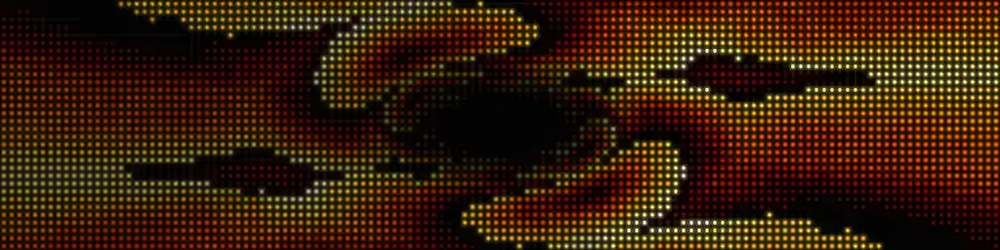
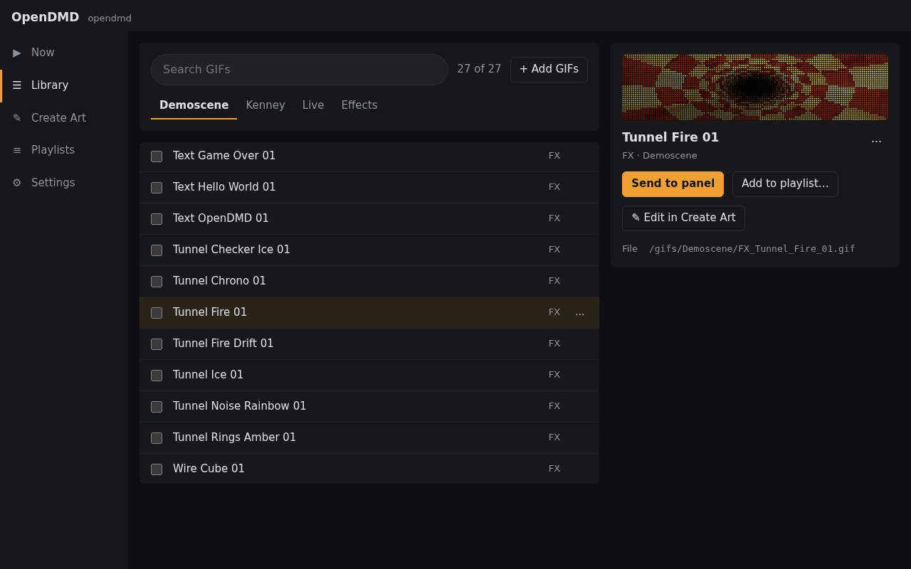
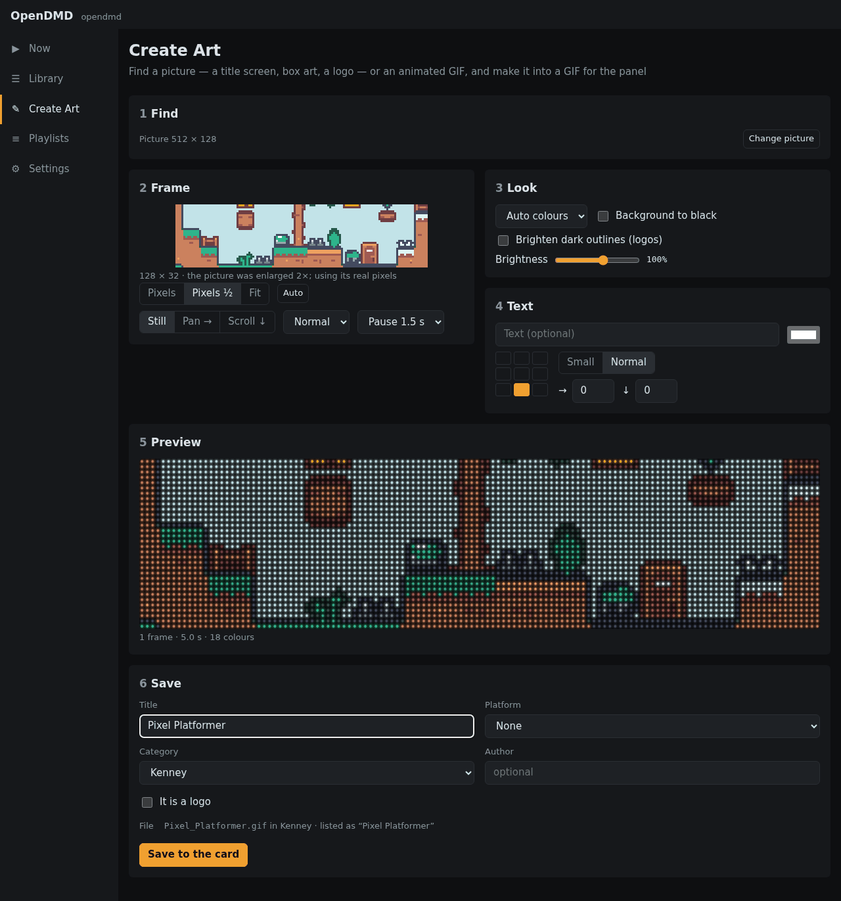
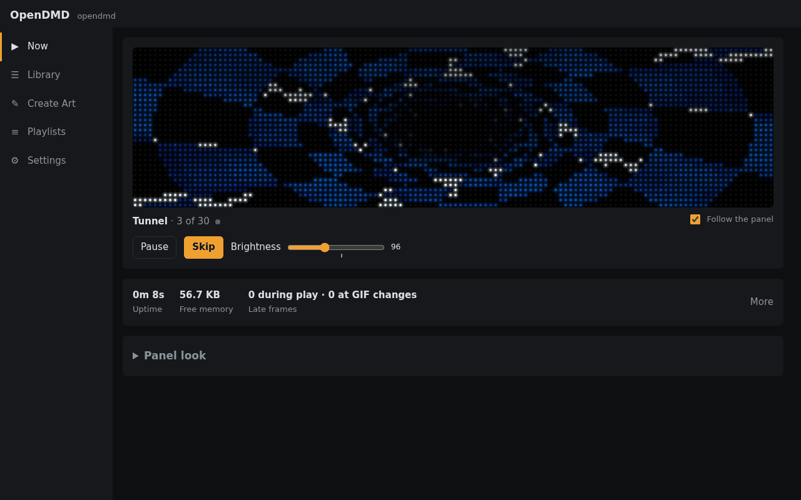
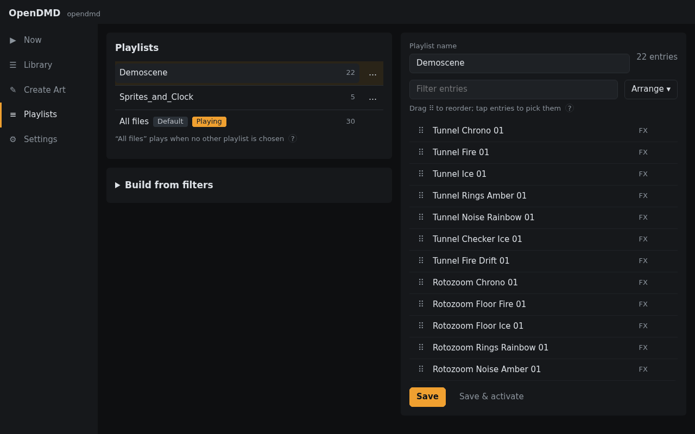
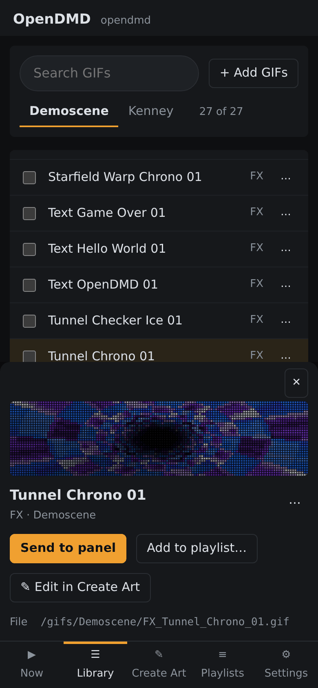

<h1 align="center">OpenDMD</h1>

<p align="center">Open firmware for 128x32 LED dot-matrix displays that play animated GIFs.</p>

<p align="center">
  <a href="LICENSE-APACHE"></a>
</p>



OpenDMD is an open-source replacement for **DMDoS**, the closed ESP32 firmware that plays GIFs
from a microSD card on two chained 64x32 HUB75 panels: a "DMD", like the dot-matrix display in a
pinball machine. It plays an existing DMDoS card as it is, and adds a web app to manage it.

- **The firmware** runs on a classic ESP32 (4 MB flash, no PSRAM). It plays the card, serves the
  web app from its own flash, and answers a small JSON API.
- **The web app** at `http://opendmd.local/` is WebAssembly. Previews, playlist filtering and GIF
  preparation run in the browser, using the same Rust engine as the player.
- **The simulator** plays a card in a desktop window, drawn as LEDs rather than flat pixels.

## Install

Build a release, then flash it over USB from Chrome or Edge:

```sh
make fw-release     # dist/: firmware, web app, merged image, signed update bundle
make flasher        # http://localhost:8765 -> Install
```

On first boot the player opens a WiFi network called `OpenDMD-Setup`. Join it, enter your WiFi
details, and the player rejoins your network as `opendmd.local`. Later updates go over WiFi:

```sh
make fw-ota HOST=opendmd.local       # firmware
make www-push HOST=opendmd.local     # web app only
```

[`docs/deploying.md`](docs/deploying.md) covers preparing a card, first boot, and recovering
from an update that goes wrong.

## What it does

- **Library:** search, browse by category and platform, preview each GIF with the panel look,
  send it to the panel, and add, rename or delete GIFs.
- **Playlists:** build them by platform, category and title words, then reorder and switch
  between them live. A GIF can be a favourite in one playlist and hidden in another.
- **Create Art:** find game screenshots, boxes and logos, or GeoCities GIFs, or use your own
  picture. Frame it, recolour it, add text, trim frames, and save it as a GIF ready for the panel.
- **Smooth motion:** adds the in-between frames to GIFs that move in jerky steps, without
  changing the file.
- **Live items and effects:** a clock, scrolling text, a tunnel, Mode 7 rotozoom, a starfield
  and wireframe shapes, all drawn on the panel and usable in any playlist.
- **Looks:** full colour or a single amber, red, green, blue or white, with optional phosphor glow.
- **Schedules:** a playlist or brightness for parts of the week, and a night mode that turns the
  panel off or dims it.
- **Smooth playback:** the player prepares a lighter copy of each GIF in the background, so files
  decode in less memory and open faster.

## Screenshots

| Library | Create Art |
| --- | --- |
|  |  |
| **Now playing** | **Effects** |
|  |  |
| **Playlists** | **On a phone** |
|  |  |

The demo card in these screenshots holds the panel's own effects and the
[Kenney Pixel Platformer](https://kenney.nl/assets/pixel-platformer) sprites (CC0).

## Documentation

- [The web app](docs/web-app.md): its views, Create Art, and the mock device
- [HTTP API](docs/api.md): every route, with `curl` examples
- [Firmware](docs/firmware.md): toolchain, flashing, WiFi setup, memory and timing
- [The card](docs/card.md): layout, prepared copies and the file-name tag grammar
- [The simulator](docs/simulator.md): its options and LED model
- [Deploying](docs/deploying.md) and [firmware updates over WiFi](docs/ota.md)
- [Hardware pinout](hardware/PINOUT.md)

## Development

The core, renderer, simulator and card tools build with stable Rust on any desktop. The web app
needs the `wasm32-unknown-unknown` target and `wasm-pack`. The firmware needs the Espressif
xtensa toolchain (see [Firmware](docs/firmware.md#toolchain)).

```sh
make test                    # unit tests for every host crate
make clippy                  # clippy -D warnings, every crate
make sim ARGS="--root /path/to/card"
make web && make web-mock ROOT=/path/to/card   # the web app against a fake device on :8080
make web-smoke               # headless Chromium through every view
make fw-build                # the firmware (first build fetches ESP-IDF)
```

| Crate | What it is |
| --- | --- |
| `opendmd-core` | Manifests, tag parsing, filtering, scheduling, GIF playback and the playlist engine. No I/O. |
| `opendmd-render` | The LED-panel renderer used by the simulator and the web app |
| `opendmd-sim` | The desktop simulator |
| `opendmd-web` | The web app: wasm module plus hand-written HTML, CSS and JS in `www/` |
| `opendmd-art-web` | Create Art's image processing and GIF writer, loaded on demand |
| `opendmd-pack` | Prepares a card's GIF copies offline |
| `firmware` | The ESP32 firmware |

The crates are deliberately not a Cargo workspace. [CLAUDE.md](CLAUDE.md) has detailed
architecture notes for contributors.

## License

Either [Apache 2.0](LICENSE-APACHE) or [MIT](LICENSE-MIT), at your option. Contributions are
dual licensed the same way.

**The DMDoS GIF pack is not part of this repository.** The ~11,000 animations on a DMDoS card
are third-party content that isn't ours to relicense or redistribute, and they must never be
committed here. `.gitignore` guards against it, and every test fixture is a GIF generated in
code at test time.
