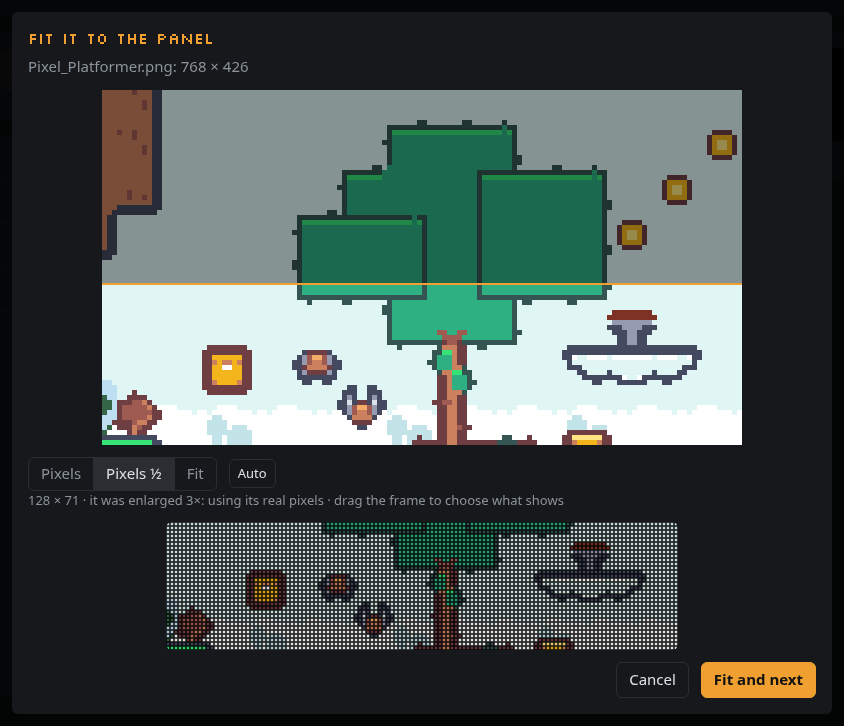

# Adding your own art

Your display's web app adds the GIFs and pictures you already have, from
the computer or phone you're using. To find art on the web, use
[the Studio](https://opendmd.dev/studio/#import) on the OpenDMD website
([below](#finding-art-online)).

## Adding a picture or a GIF

In the **Library**, press **+ Add ▾**, then **Add GIFs…**, and pick one or
more files: GIFs, or pictures such as PNG or JPEG. You can also drop files
anywhere on the Library, or paste a picture you've copied. (A web address
dropped or pasted isn't fetched: use **Find art online** for that.)

A GIF that is already 128 × 32, the panel's size, goes straight to its
details. Anything else is fitted to the panel first, one file at a time:

- **Pixels** keeps the picture's own pixels, one per dot: best for game
  screenshots and pixel art. A screenshot that was enlarged is spotted and
  shrunk back.
- **Pixels ½** halves it.
- **Fit** shrinks the whole picture, a logo or a photo, to the panel.
- **Auto** picks for you again.

The panel is a strip of 128 by 32 dots, drawn as a frame over the picture.
Drag the frame, or tap the picture, to choose what shows; the preview under
it is drawn the way the LEDs look. The web app then makes a GIF of it in the
colours the panel shows, keeping every frame of an animation.

A GIF can also go on **as it is**: press **Add as it is**. The panel plays
a GIF of any size, showing its middle 128 × 32, and keeps every frame
however long the GIF is. A GIF with thousands of frames starts that way.

Press **Fit and next** (or **Next**), then give each one a title, a
platform, a category and, if you like, an author, as for any GIF
([Adding GIFs](web-app.md#adding-gifs)). Nothing goes on the card until you
press **Add GIF**. **Cancel** leaves that file out.

A Formula's **Save as GIF…** makes a GIF of one loop and opens the same
details, filled in ([Saving as a GIF](formulas.md#saving-as-a-gif)).

## Changing a GIF already on the card

The display's web app doesn't edit a GIF's frames, colours or timing. To
trim it, change its speed, add text or recolour it, open it in the
Studio: in the Library, open the GIF and choose **… › Download GIF**, then
in the [Studio's Import](https://opendmd.dev/studio/#import) choose that
file, make your changes and press **Send to panel**. It comes back into
Add GIFs as a new GIF; **… › Delete…** removes the old one, and **Edit
details…** changes only its title, platform, category or author.

## Finding art online

In the Library, **+ Add ▾ › Find art online** opens the Studio's Import on
[opendmd.dev](https://opendmd.dev/studio/#import) in a new tab. When a
search in the Library finds nothing, the **Find art online** link beside
"Nothing here matches" takes the same words there, with the platform you
picked.

The Studio searches game art (title screens, box art and logos) and old
GeoCities GIFs, takes a picture or a GIF from a web address or another
site, and makes videos into GIFs. It needs an internet connection on your
computer or phone, not on the display. When the GIF is ready, **Send to
panel** asks once for your display's address (the name or IP address it
shows), then opens your display's web app with the GIF in **Add GIFs**,
ready to add. Your computer or phone must be on the same network as the
display, or linked to it by [Remote control](remote.md). **Download GIF**
saves it instead, to add with **Add GIFs…**.
