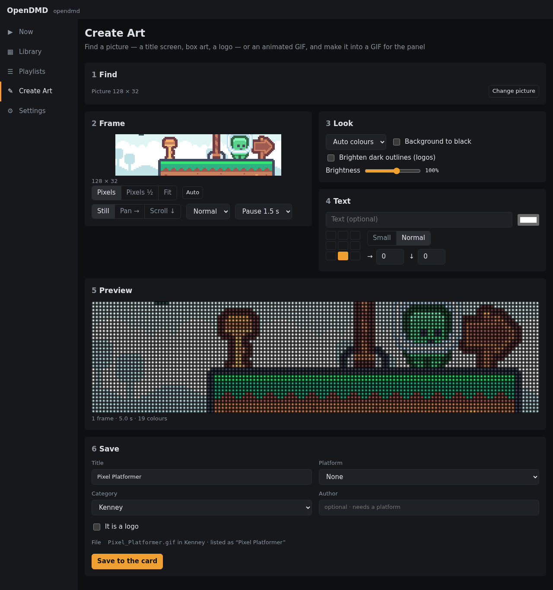

# Create Art

Create Art turns a picture or an animated GIF into art sized for the panel.
Find game art on the web, use an old GeoCities GIF, or bring your own
picture, then frame it, tidy it up and save it to your card. Nothing is
added to the card until you save.

It works in six steps. Until you've picked something only step 1 shows;
after that it folds away (**Change picture** opens it again) and the other
steps appear.

Create Art is also on the project site, at
[opendmd.dev/create/](https://opendmd.dev/create/), with the same steps.
There **Send to my panel** asks for your panel's address once (the name or
IP address it shows), then opens your panel's web app with the GIF ready to
add: pick its folder and press **Add GIF**. Your computer or phone must be
on the same network as the panel. **Download GIF** saves it instead; Library
→ **Add GIFs** in your panel's web app puts it on the card.

## 1. Find

Pick a source:

- **Game art:** choose a platform, type a game's title, and pick from its
  title screens, in-game shots, box art and logos.
- **GifCities:** search the Internet Archive's collection of GIFs from old
  GeoCities pages. **Wide (suits the panel)** shows the ones that fit the
  panel's long shape best.
- **Your own:** choose a file, or paste a web address. You can also drop a
  picture onto the page, or paste one you've copied.

Click a result to load it. Searching for art needs an internet connection
(the computer or phone you're using needs it, not the display): the list of
games comes from the OpenDMD website, the pictures from where they're kept.
If it can't be reached, Find says so; **Try again** when you're back online.

Some sites don't let other pages load their pictures. On
[opendmd.dev/create/](https://opendmd.dev/create/) Create Art then fetches
the picture for you, through the OpenDMD website, and keeps nothing; it
says so plainly if the file is too big (over 16 MB), isn't a picture or a
video, or the site refused. In your panel's own web app, download the
picture and add the file instead.

On the website, `opendmd.dev/create/?url=` followed by a picture's address
opens it in Create Art straight away. The address of a page works too (a
Tenor, GIPHY, Reddit or Imgur link, as their Share buttons give it):
Create Art finds the GIF or video on it.

### Bringing a GIF from another site

On the website, **Your own** has links that search other sites for pixel
art with your words: Tenor, Klipy, GIPHY, Google and Bing images (animated
only), DuckDuckGo, Reddit's r/PixelArt, Tumblr, DeviantArt and Imgur. Each
opens in a new tab. When you find one, bring it back:

- **On a computer:** right-click the GIF and pick **Copy Image Address**
  (or **Copy Image**), then paste it into Create Art; or drag the GIF onto
  the page. The **Open in Create Art** bookmarklet does it in one press:
  drag it from Your own to your bookmarks bar, then press it on a page
  with a GIF.
- **On Android:** install Create Art (your browser's menu → **Add to Home
  screen** or **Install app**). It then appears in the Share menu: share a
  GIF, a video or a link to **Create Art** and it opens there.
- **On iPhone and iPad:** there is no Share menu entry for websites. Touch
  and hold the GIF, then **Copy** (or **Save to Photos**), or press Share →
  **Copy** on a link. In Create Art paste it into the address box (or press
  **Choose a picture, GIF or video…** and pick it from Photos).

### Videos

On the website Create Art also takes MP4 and WebM videos, from a file, a
link or a share: many "GIFs" on the web are really videos. The first 10
seconds become up to 20 frames a second, fitted to the panel; trim and
edit them on the timeline as for any animation. In your panel's own web
app, make the video into a GIF on the website first.

## 2. Frame

The panel is a wide strip, 128 by 32 dots, shown as a window over your
picture. Drag the picture to choose what shows, or press **Auto** to let the
app pick the busiest part.

- **Pixels** keeps the picture's own pixels, one per dot: best for game
  screenshots and pixel art. Enlarged screenshots are spotted and shrunk
  back automatically.
- **Pixels ½** halves it.
- **Fit** shrinks a logo or photo to the panel's height.

A still picture can also slowly **Pan →** or **Scroll ↓** across the panel.

## 3. Look

Adjust colours and brightness so it reads well on LEDs. **Brighten dark
outlines** helps black lines and lettering, which disappear on a panel
because black LEDs are simply off.

## 4. Text

Add a line of text in the panel's own font, in any colour, at one of nine
spots. On an animation you can put it on every frame or only some.

## 5. Preview

See it playing as it will look on the panel. For an animation there is a
timeline of frames: trim the start and end, delete frames, change the speed,
play it backwards or there-and-back (**Ping-pong**), and choose how many
times it plays. **Undo** is there if you change your mind.

If the animation moves in jumpy steps, a **Smooth motion** switch offers to
fill in the in-between frames.

## 6. Save

Give it a title, a platform, a category and an author, as when adding GIFs.
The app shows the name it will get and how the Library will list it. Saving
puts it on your card, ready to play, and offers to add it to the playlist
that's playing.

## Editing a GIF you already have

In the Library, open a GIF and choose **Edit in Create Art**. It loads with
all its frames and details. When you save, **Replace the original** keeps it
in every playlist it's in, or **Save as new** keeps both.
