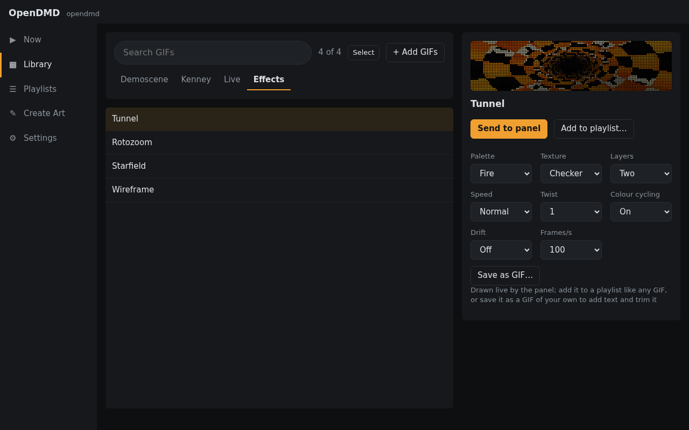

# Effects and live items

Besides your GIFs, the panel can draw a few things by itself. Find them in
the Library under the **Live** and **Effects** tabs. Preview them, send them
to the panel, or add them to any playlist, just like a GIF.

## Live

- **Clock:** the time, in one of four layouts, with the date and seconds if
  you want them. The player keeps its own time over the internet; set your
  time zone in **Settings → Advanced → Time**.
- **Scrolling text:** type a message ("Game over", "Insert coin") and choose
  its font, colour and speed.

## Effects

Classic demo-scene and 16-bit style animations, drawn live:

- **Tunnel:** a spinning time-warp tunnel.
- **Rotozoom:** Mode 7 style turning, zooming patterns, or a floor rushing
  to the horizon.
- **Starfield:** flying through stars, as warp streaks or dots.
- **Wireframe:** spinning 3D shapes, from a cube to a shape-shifting torus.

Each has a few options beside its preview, such as colour palette, texture
and speed.

## Colour and glow

Two settings change the look of everything the panel shows, GIFs included.
Find them in **Settings → Playback**:

- **Colour:** full colour, or a single colour like a classic pinball
  display: amber, red, green, blue or white.
- **Phosphor glow:** dots fade out gently instead of switching off, like an
  old plasma display. **Short** or **Long**, or **Off**.
