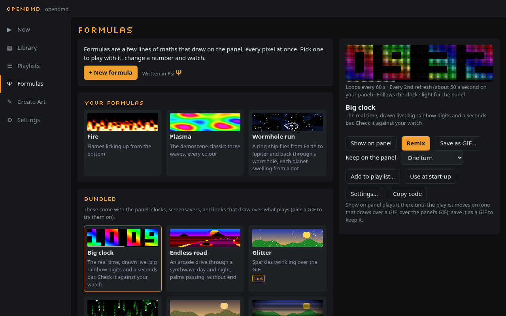

# Formulas



A formula is a few lines of maths that draw on the panel, every pixel at
once. Change a number and the picture changes as you type. Formulas are
written in **Psi** (Ψ), OpenDMD's small language for the panel's pixels,
but you don't need to know it to start: open an example, drag a number,
and watch.

Open **Formulas** (Ψ) in the app's menu. Formulas work in the
[online demo](https://opendmd.github.io/demo/) too, with no player at all.

## The gallery

Formulas opens on the examples (Big clock, plasma, fire, rain, a clock
face, and more) and the formulas you've saved. Pick one
to see it playing in the panel look, with its sliders if it has any.

**Big clock**, the first example, shows what a GIF can't do: it draws
the real time in big rainbow digits, with a bar along the bottom that
fills once a minute, a step a second. Check it against your watch. A GIF
can't know the time; one that only showed each minute of a day would
already be 2.7 MB, and with the seconds and the moving colours it would
be gigabytes. The formula is under 1 KB, most of it comments.

From there:

- **Remix** (an example) or **Edit** (one of yours) opens it in the editor.
- **Save as GIF…** makes a GIF of it in [Create Art](create-art.md).
- **Copy share link** gives you a link to its own page, for anyone (see
  [Sharing](#sharing)).
- **+ New formula** starts a fresh one.

If you leave the editor without saving, the gallery offers **Continue
editing** at the top, and the app asks before anything replaces it.

On your player, **Show on panel** plays a formula there until the
playlist moves on. **Add to playlist…** puts it in one of your playlists
(the same list of playlists the Library offers), where the player draws it
itself: it follows the clock, loops for as long as it plays and takes a
line of the playlist, not the space of a GIF. The playlist shows it by its
name, marked *Formula*, and so does Now while it plays. It goes in as it is
at that moment, sliders included; change it later and add it again. (In
the online demo, Now's preview skips Formulas in a playlist: only a player
draws them there.) Formulas that draw over a GIF have their own section,
[Over a GIF](#over-a-gif).

## The editor

The preview is on top (on a phone it stays in view while you scroll) and
the formula underneath; the preview follows as you type. Under it, a line
says how long the loop is (or that the formula follows the clock) and how
hard it is for the panel. If something is wrong, the editor says what in
plain words just above the formula, marks the place, and keeps playing the
last version that worked, dimmed.

- **Drag a number** left or right to try other values. On a computer, drag
  it right in the text, or put the cursor on it and press Alt + ↑ or ↓
  (Shift for bigger steps). On a phone, tap a number and drag the bar that
  appears under the formula, or use its − and + buttons. Numbers can go
  below zero. Ctrl+Z (⌘Z) undoes a whole drag at once.
- **Controls:** a line at the top like `control speed 0..4 = 1 "Speed"`
  gives the formula a slider: `speed` is a value you use in it, from 0 to 4,
  starting at 1, labelled "Speed" (the range is 0 to 1 when you leave it
  out, the label the name). A line that lists words,
  `control shape = cube, octahedron, icosahedron`, makes a row of buttons
  (two to six words; two make a switch): `shape` is the chosen word's
  number, 0 for the first, so read it with `pick(shape, …)`. Up to three
  controls; they travel with the formula, so its name, controls and
  defaults are the same in a share link, a playlist and on the panel. A
  formula that uses `a`, `b` or `c` without a `control` line gets a plain
  slider, 0 to 1, for each.
- **Name and look:** `name "My sunrise"` and `about "…"` at the top say
  what it is called and what it is; `look screen 40` says it can be the
  panel's look, drawn over every GIF with that blend and amount.
- **Cheat sheet** lists everything the language has, with a line on each.
  Tap a name to put it in.
- **Save** keeps the formula in this browser, under its name.

## A plasma in two minutes

Press **+ New formula**, clear the text, and build it up line by line.

1. Start with a gradient. `x` goes from 0 at the left edge to 1 at the
   right, and `gray` turns a number from 0 to 1 into black to white:

   ```
   gray(x)
   ```

2. Make waves. `sin` goes up and down between −1 and 1 once for every 1 it
   is given, so `x*2` gives two waves across the panel. Halve it and add a
   half to keep it between 0 and 1:

   ```
   gray(sin(x*2)*0.5 + 0.5)
   ```

3. Set it moving. `t` is the time in seconds; `loop 8` makes the loop eight
   seconds long, and `t/8` moves the wave once along in that time, so it
   loops without a jump:

   ```
   loop 8
   gray(sin(x*2 + t/8)*0.5 + 0.5)
   ```

4. Add a second wave going up and down the panel (`y` is 0 at the bottom, 1
   at the top), moving the other way and twice as fast. Give the sum a name:

   ```
   loop 8
   wave = sin(x*2 + t/8) + sin(y*1.5 - t/4)
   gray(wave/4 + 0.5)
   ```

5. Colour it. `hsv` takes a hue (once round the rainbow for every 1), a
   saturation and a brightness. Let the wave pick the hue, and turn the
   rainbow once a loop:

   ```
   loop 8
   wave = sin(x*2 + t/8) + sin(y*1.5 - t/4)
   hsv(wave/4 + t/8, 1, 1)
   ```

6. One more wave, on a slant, and it's the Plasma example:

   ```
   loop 8
   wave = sin(x*2 + t/8) + sin(y*1.5 - t/4) + sin(x*1.5 + y + t/8)
   hsv(wave/6 + t/8, 0.9, 1)
   ```

Now drag the `2` in `x*2`, or the `0.9`, and see what happens.

## The language

A formula is a few lines: names you set (`wave = …`, each name once), and a
colour on the last line. It is worked out for every pixel, every frame.
`--` starts a comment. Everything is a number; there are no loops, lists or
words (a single character in quotes, `'A'`, is a number too: its code).

**Values**

| name | what |
| --- | --- |
| `x`, `y` | where the pixel is: 0 to 1 across (left to right) and up (bottom to top) |
| `px`, `py` | the pixel's column, 0–127, and row from the bottom, 0–31 |
| `i` | the pixel's number, 0–4095, from the top left |
| `t` | seconds into the loop (with `loop forever`, since the formula started) |
| `seed` | with `loop forever`: 0 to 1, a new one each time it plays |
| `hour`, `minute`, `second` | the time of day |
| `a`, `b`, `c` | the controls, in the order the `control` lines declare them (0 to 1 when there is no `control` line) |
| `w`, `h` | 128 and 32 |
| `cx`, `cy` | where the pixel is from the middle, in panel heights: `cx` from −2 at the left edge to 2 at the right, `cy` from −0.5 at the bottom to 0.5 at the top |
| `r`, `angle` | how far the pixel is from the middle (round, though the panel is 4 times wider than tall: `r < 0.4` is a disc), and its angle round the middle, in turns |
| `ty` | the pixel's row counted from the top, 0–31 |

**Functions.** Waves and angles are in *turns*, not degrees or radians:
`sin(0.25)` is 1, and `sin` repeats every 1.

| function | what |
| --- | --- |
| `sin(v)`, `cos(v)` | a smooth wave between −1 and 1 |
| `tri(v)`, `saw(v)`, `sqr(v)` | triangle, sawtooth and square waves, −1 to 1 |
| `abs(v)`, `floor(v)`, `frac(v)`, `sqrt(v)` | size, whole part, fraction, square root |
| `min(a, b)`, `max(a, b)`, `clamp(v, lo, hi)` | limits |
| `mix(a, b, k)` | from `a` to `b` as `k` goes from 0 to 1 |
| `step(edge, v)` | 1 when `v` is past `edge`, else 0 |
| `smoothstep(e0, e1, v)` | a soft step from 0 to 1 |
| `len(dx, dy)` | the distance, √(dx² + dy²) |
| `atan2(dy, dx)` | an angle, in turns (−½ to ½) |
| `noise(x, y, z)` | smooth random hills, 0 to 1 |
| `hash(a, b)` | a random number, 0 to 1 |
| `c ? a : b`, `select(c, a, b)` | `a` when `c` is true (not 0), else `b` |
| `digit(n, col, row)` | 1 where digit `n` (0 to 9) has a pixel in the panel's font, else 0 |
| `glyph(ch, col, row)` | the same for a character: `glyph('A', col, row)` |
| `bit(n, i)` | bit `i` of the whole number `n`, 1 or 0, for patterns of your own |
| `pick(k, a, b, …)` | `a` when `k` is 0 (up to 1), `b` when it is 1, and so on; 0 below 0 or past the last |

**Digits and letters.** `digit` and `glyph` read the panel's own font, the
one the clock and the title cards use: a character is 5 columns by 7 rows
(`col` 0 to 4 from the left, `row` 0 to 6 from the top; a digit uses
columns 0 to 3 and rows 0 to 5, the rest is the gap to the next one).
Anything outside that, or a character the font hasn't, is 0, so a
character drawn big is just its column and row worked out from the pixel:
`digit(7, floor(px/4), floor(ty/4))` draws a 7 four times the size in the
top-left corner (rows count down from the top here, as `ty` does; `py`
counts up). `pick` chooses which character goes where:
`glyph(pick(floor(px/5), 'H', 'I'), px % 5, ty)` writes HI in the top
left, and nothing after it. Add `small` for the smaller font, 4 by 6 (digits 3 by 5):
`digit(n, col, row, small)`, or `bold` for chunky 3 by 5 digits (digits
only): `digit(n, col, row, bold)`. **Big clock** is made this way, in
`bold`.

Operators: `+ - * / %`, comparisons `< <= > >= == !=` (1 for true, 0 for
false), and `and`, `or`, `not`. There is no power operator: write `x * x`.

**Colour** (the last line):

| colour | what |
| --- | --- |
| `hsv(hue, sat, val)` | hue in turns; saturation and brightness 0 to 1 |
| `rgb(r, g, b)` | red, green and blue, 0 to 1 each |
| `pal(name, v)` | a palette, `v` from 0 to 1: `fire`, `ice` (or `ocean`), `chrono`, `amber`, `rainbow`, `gray` |
| `pal(name, v) * k` | the palette's colour, dimmed (or brightened) by `k`: a light or a fog on it |
| `gray(v)` | black to white |
| `#ff8800` | a colour by its red, green and blue, two hex digits each (`#f80` for short) |

A last line that is just a number is `gray` of it.

**Your own palettes.** `palette sea = #001020, #0060a0, #40c0e0, #ffffff`
on a line near the top makes a palette of your own colours (up to 32 of
them, and up to three palettes in a formula), used like the others:
`pal(sea, v)`. `pal(sea, 0)` is the first colour and `pal(sea, 1)` the
last; with four colours, `pal(sea, 1/3)` is the second and `pal(sea, 2/3)`
the third. In between you get the nearest colour, in bands — handy with a
sprite or `floor(…)` choosing which colour each pixel is.

**Colours by name.** `#ff8800` is a colour, the way web pages write them.
It can be the whole last line, and you can do sums with colours there:
`#ff8800 * k` is that orange at brightness `k`, `mix(#102040, #ff8800, y)`
goes from dark blue at the bottom to orange at the top, and
`pick(k, #ff0000, #00ff00)` picks one. `rgb(#ff8800, k)` covers only `k`
of the pixel. A colour can't be given a name of its own (`c = #ff8800` is
an error): write it in the last line, where it is used. In the editor a
colour is underlined in its own colour.

**The loop and the frame.** `loop N` on a line of its own sets how long
the loop is, in seconds (8 if you leave it out). For a seamless loop,
everything that moves should come back to where it started: use `t/N`,
`t*2/N` and so on with the loop's own `N`. Values inside `frame { … }`
are worked out once a frame rather than for every pixel; they can't use
the pixel's position.

**Going on without repeating.** `loop forever` instead of `loop N` is a
formula with no loop at all: `t` counts the seconds since it started, for
as long as it plays, so a road, a sky or clouds never come round to where
they began (the Endless road example drives on like this). Each time it
plays it starts again from `t = 0`, but with a new `seed`, a number from 0
to 1: add `seed*1000` to a distance and it starts somewhere else every
time. Such a `t` can't go everywhere a number can: use it inside `frac`,
`sin`, `cos`, `noise`, `hash`, `%`, a comparison, `min`, `max` or
`smoothstep` (after adding or multiplying it by numbers that are the same
for every pixel, and adding the pixel's own part last: `noise(x*8 + t, y*4,
0)`), and the editor says so where it can't. In the editor's preview it
starts when the preview does; **Save as GIF…** keeps its first 10 seconds.

```
loop forever
frame { u = t*0.05 + seed*1000 }
k = smoothstep(0.45, 0.75, noise(x*6 + u, y*3, u*0.3))
mix(#204080, #f0f0ff, k)
```

**Frames a second.** A formula plays at 50 frames a second. `fps 100` on a
line of its own (like `loop`) asks for 100, for things that move fast —
the Starfield and Wireframe cube examples use it — and `fps 25` for 25.
100 only happens for a formula light enough (about 5 ms a frame on the
panel); a heavier one plays at 50. A link to the panel that says `fps=`
wins over the line. Drawn over a GIF, a formula follows the GIF's frames
and its `fps` line is not used.

**Layers.** A formula can be a stack of layers, bottom to top, each with
its own names and its own colour on its last line:

```
loop 4
layer {
  wave = sin(x*2 + t/4) + sin(y*1.5 - t/2)
  hsv(wave/4 + t/4, 0.9, 1)
}
layer multiply { gray(py % 2 ? 1 : 0.6) }
```

The word after `layer` says how it goes onto what is below it: `over`
(the default: it covers it), `add` (lighter), `multiply` (darker: white
leaves it as it was), `screen` (lighter, softly), `max` or `min`. Names
set outside the layers can be used in all of them; names set inside a
layer are its own, so two layers can each have a `v`, and you can paste a
whole formula into a `layer { … }` to combine it with another. `loop` and
`fps` go on their own lines outside the layers.

**How much it covers.** Every colour takes one more value, if you like:
how much of the pixel it covers, from 0 to 1 — `rgb(r, g, b, k)`,
`hsv(h, s, v, k)`, `gray(v, k)`, `pal(fire, v, k)`. Where it covers less
than all, what is below shows through.

**Two formulas in one.** A formula can hold another one as a *part*:

```
loop 16
part bars {
  loop 4
  bar = max(0, 1 - abs(cy - 0.35*sin(t/4))*5)
  bar * #ff9933
}
part rings {
  loop 4
  d = r
  pal(rainbow, frac(d*1.5 - t/2))
}
k = smoothstep(0.25, 0.75, sin(t/16)*0.5 + 0.5)
layer { bars }
layer { rings(x, y, k) }
```

You don't have to type a part out: in the editor, write
`use Rings as ring` on a line of its own, with the name of one of your
formulas or an example, and when you move to another line the editor puts
that formula in as `part ring { … }`, ready to change. Everything you save or
share then has the whole of it, so it works anywhere: if a `use` line names
a formula there isn't (or the formula you're editing), the editor says so
and won't save or share until it's fixed.

- A part draws nothing until you use it. Its name on its own, as the last
  line (of the formula or of a layer), draws it: `layer { rings }`.
- `rings(x2, y2)` draws it as if each pixel were somewhere else:
  `rings(1 - x, y)` mirrors it, `rings(frac(x*4), y)` repeats it four times,
  `rings(abs(x - 0.5)*2, abs(y - 0.5)*2)` folds it like a kaleidoscope.
- Like every colour, it takes one more value, how much of the pixel it
  covers: `rings(x, y, k)`. Moving `k` with `t` fades one formula into
  another (above).
- `rings.d` is a value the part sets, here its `d`: use one formula's
  values in another, for example as how much it covers, so one formula
  decides where the other shows.
- Names inside a part are its own: it can use `d` or `wave` whatever the
  rest of the formula uses. Inside a part, `t` follows the part's own
  `loop`; make the whole formula's loop a multiple of it.

The examples **Bars to stars**, **Rings through stripes** and
**Kaleidoscope** are made this way.

**Drawing.** Some pictures aren't "each pixel decides for itself": a field
of stars, a turning wireframe, sparks. For those a formula can **draw**:
once a frame, before the pixels, a `draw { }` block draws lines and dots,
and the pixels then read what was drawn where they are as `ink`, from 0 to 1.

```
loop 4
draw {
  for k < 12 {
    an = k/12 + t/4
    line(64, 16, 64 + cos(an)*40, 16 + sin(an)*14, 0.2, 1)
  }
}
hsv(x, 0.6, ink)
```

- `line(x0, y0, x1, y1)` and `dot(x, y)` work in pixels: across from the
  left, **up from the bottom** (as `px` and `py`). One more value or two is
  the ink: `dot(x, y, 0.5)`, or `line(…, 1, 0.2)` fading from one end to
  the other. Where lines cross, the brighter one wins.
- `for k < 12 { … }` runs its lines with `k` = 0, 1, … 11 (up to 1,024;
  one loop inside another at most, and 2,048 turns a frame in all). Names
  set inside a loop are its own.
- Inside `draw { }` only things that are the same for every pixel: `t`,
  the clock, the sliders, the loop's `k`. Not `x`, `px` or `ink`.
- `table T = 1, -2, 0.5` holds numbers (256 in all) and `T[k]` reads number
  `k`, counting from 0: the corners of a shape, the edges between them, a
  little picture of your own. It works anywhere, not only in `draw`.
- The colour comes from the last line, as always: `pal(ice, ink)`,
  `#40c0ff * ink`, or over a GIF `layer screen { gray(ink) }`.
- Every frame starts empty: nothing is left over from the frame before.

The examples **Starfield** and **Wireframe cube** are made this way.

**Sprites.** A little picture can be written into the formula as it looks,
one character a pixel, with a key saying what number each character
stands for:

```
sprite ship {
  key . 0, W 1, B 0.5
  ...WW...
  ..WBBW..
  .WWWWWW.
  W.W..W.W
}
s = ship[px - 60, ty - 12]
mix(#000010, #80c0ff, s)
```

`ship[u, v]` is the number of the character at column `u` and row `v`,
counted from the sprite's top left (and 0 outside it), so moving it is
adding to `px` and `ty`, and making it bigger is dividing them. The key
comes first; up to 16 characters (not spaces, or `; { } , - /`), rows up
to 64 characters wide and 32 tall. Use the numbers for colours —
`pick(k, #000, #f00, #ff0)` — or for brightness. The Endless road's car is
one.

**Limits.** A formula can be 4,096 characters and 256 steps (the editor
shows the count). Numbers go from −32,768 to 32,767; past that they stop
at the end instead of wrapping round, and dividing by zero gives the
biggest number of the right sign rather than an error.

## Over a GIF

A formula can draw over a GIF instead of replacing it: scanlines, a colour
grade, a vignette, sparkles, a clock in the corner. Four values say what
is under it at the pixel:

| name | what |
| --- | --- |
| `ur`, `ug`, `ub` | the red, green and blue under the formula, 0 to 1 |
| `ul` | how bright it is there, 0 to 1 |

The bottom layer, and any colour that covers less than all of a pixel,
let it show through. For example, a sepia tone:

```
rgb(ul*1.1 + 0.08, ul*0.92 + 0.04, ul*0.65)
```

or scanlines, which keep the GIF and darken every other row:

```
layer multiply { gray(py % 2 ? 1 : 0.55) }
```

The examples' **Over a GIF** section has more. In the editor and in a
formula's details, such a formula is drawn over a sample picture; **Pick a
GIF…** draws it over one of your GIFs (from the playlist) or a GIF file
from your computer instead, moving as the GIF does. **Save as GIF…** then
saves the formula over that GIF. A formula played on its own has nothing
under it: `ur`, `ug`, `ub` and `ul` are 0 (black).

On your player:

- **Show over the panel’s GIF** draws it over whatever the panel is
  playing, until the playlist moves on (changes you make follow it there).
  Press it again to take it off.
- **Set as the panel’s look** keeps it over every GIF the panel plays,
  before the colour and the phosphor glow, for a formula that says it can
  be a look (below). Settings › Look shows which formula it is (**Formula
  over every GIF**), changes it and turns it off (**None**).

**Any formula can be the look** once its settings say so. In the editor,
**⚙ Settings** (or **Settings…** in a formula's details) is one sheet for
what the formula says about itself: its **Name**, a line **About** it, its
**Controls** (a slider with its range, default and label, or a choice of
words; three at most) and **Can be the panel’s look**. Every change there
is a line at the top of the formula — `name "…"`, `about "…"`,
`control …`, `look …` — so the text and the sheet always agree, and the
formula carries them wherever it goes (a share link, a playlist, the
panel). Turned on, the look has a **Blend** and an **Amount**. The blend
says how the formula goes onto the GIF — **Over** (it covers it),
**Screen** (it lightens: the GIF's bright parts stay and the formula shows
in its dark ones), **Add**, **Multiply** (it darkens and tints),
**Lighten** or **Darken** (the brighter or darker of the two) — and the
amount how much of it shows, 0 to 100 %. A formula that draws over a GIF
already starts at Over, 100 %. One that covers the whole panel, like
Plasma, starts at Screen, 40 % (or Over, 30 % when that is lighter for the
panel), and the preview shows the choice as you move it. A formula with
layers of its own goes Over only (its layers keep their own blends).

Settings › Look lists your formulas and the bundled ones that can be a
look, and says how the chosen one goes on; **Change…** opens its settings.
Over at 100 % of a formula that covers the whole panel would hide the GIF,
so the sheet says so (choose a lower amount or another blend), and a
formula too heavy to draw over every GIF (more than about 12 ms a frame on
the panel, the blend included) is listed as too heavy. The sheet says how
fast the look moves: about 50 times a second, or 25 for a heavy one (over
8 ms); the GIFs play at their own speed either way. Looks stand alone: the
player is sent the whole formula, so a look keeps working even after the
formula is edited or deleted here. When the player is short of memory
(several downloads at once, say) it shows the GIFs without the formula for
a while.

## Keeping them fast

Formulas are made to run on the panel's own small processor too, which
draws every pixel 50 times a second (100 with `fps 100`, for a formula
that is light: about 5 ms a frame or less). The editor rates each one **light**,
**medium** or **heavy** for the panel (hover for an estimate in
milliseconds); all the examples are light or medium.

- Cheap: `+ - *`, the waves (`sin`, `cos`, `tri`, `saw`, `sqr`), `abs`,
  `frac`, `min`, `max`, `clamp`, `step`, comparisons, `pal`, `digit`,
  `glyph`, `bit`, and `pick` of numbers, letters or values from
  `frame { }` (one step, however many it picks from).
- Dividing by a fixed number (`x/8`) is free: it becomes a multiply.
- Dear: `noise`, `len`, `sqrt`, `atan2`, `smoothstep`, `hash`, and dividing
  by something that changes from pixel to pixel (`r` is a `len`, `angle`
  an `atan2`). One of them is fine; several add up.
- A sum with colours is worked out once for red, once for green, once
  for blue: `#ff8800 * k` costs one multiply (a channel of `ff` is
  free, of `00` nothing).
- Anything that doesn't depend on the pixel (`hour/12`, `sin(t/8)`) is
  worked out once a frame, whatever line it's on.
- Each layer costs about as much as a `smoothstep`; `screen` and colours
  that cover only part of a pixel a little more.
- A part costs what its formula costs, once for each place it is drawn
  at: two formulas in one cost about as much as both.
- Drawing costs by the line, not by the pixel: a few hundred lines a frame
  is light. A loop's lines count as often as it turns.
- Anything worked out from the pixel's column and the time only
  (`sin(x*3 + t/8)`) is worked out once a frame for each column, not for
  every pixel: almost free.
- Anything worked out from the pixel's place alone, never the time or a
  slider (a tunnel's depth `1/len(…)`, `atan2(…)`, `r`, `angle`), the panel
  works out once and keeps, while it has the memory to spare (up to two
  such values a formula): then even `len` and `atan2` cost nothing a frame.
  The **Tunnel** example is made this way. Over a GIF (as the look) they
  are worked out every frame, so the editor may rate such a formula heavier
  as a look.

## Sharing

**Copy share link** gives a link to the formula's own page on the OpenDMD
site, with the whole formula in it, its name and its sliders. Anyone can
open it, with or without a player: the page plays it in the panel look,
shows its code and its sliders, and has

- **Open on my display**: asks once for your display's address (it
  suggests `opendmd.local`; the name or IP address your display shows) and
  opens the formula in your display's editor, where you can save it. Your
  phone or computer must be on the same network as the display.
- **Try it in the demo**: opens it in the [online demo](https://opendmd.github.io/demo/)'s
  editor.
- **Copy code** and **Copy link**, and a QR code of the link to open it on
  a phone.
- **Submit to the gallery** (see [The formula gallery](#the-formula-gallery)).

On your player, the share box also has **Copy a link to this display**:
that one opens the formula in your own player's app, on your own network.
Keep formulas short to share them: past about 1,500 characters the link
gets long enough that some apps cut it, and the share box says so.

## The formula gallery

The [formula gallery](https://opendmd.github.io/formulas/) on the OpenDMD
site has formulas people have made, and the examples. **Open** shows one on
its own page; **Remix** opens it in the demo's editor.

To add yours, open its share link and press **Submit to the gallery**: give
it a description, your name or GitHub handle and a licence (CC0, anyone may
use it; or CC BY 4.0, with credit), then **Open on GitHub**. GitHub opens
with the file ready and makes the pull request for you (you need a free
GitHub account). A check says if anything needs fixing, a maintainer looks
at it, and once it's merged it appears in the gallery within a few
minutes. The gallery takes formulas that are light enough for the panel
(at most 10 ms a frame as the editor estimates it) and at most 4 KB.
The details are in the gallery's
[README](https://github.com/opendmd/opendmd.github.io/tree/main/gallery).

## Saving as a GIF

**Save as GIF…** draws one loop of the formula, at 50 frames a second (25
for loops longer than about 5 seconds or with `fps 25`, and at most 240
frames; GIFs can't play 100 a second, so `fps 100` saves at 50), and opens
it in [Create Art](create-art.md), titled with its name. Add text, trim it
or change its speed there, then save it to your card: it plays on the panel
like any other GIF and goes in playlists. A formula with a long loop, or one that follows the
clock, keeps only those few seconds, as they look when you save; one that
goes on without repeating (`loop forever`), its first 10 seconds.

Formulas you save are kept in this browser. Another browser, or a cleared
browser, won't have them: share a link to yourself to move one.

