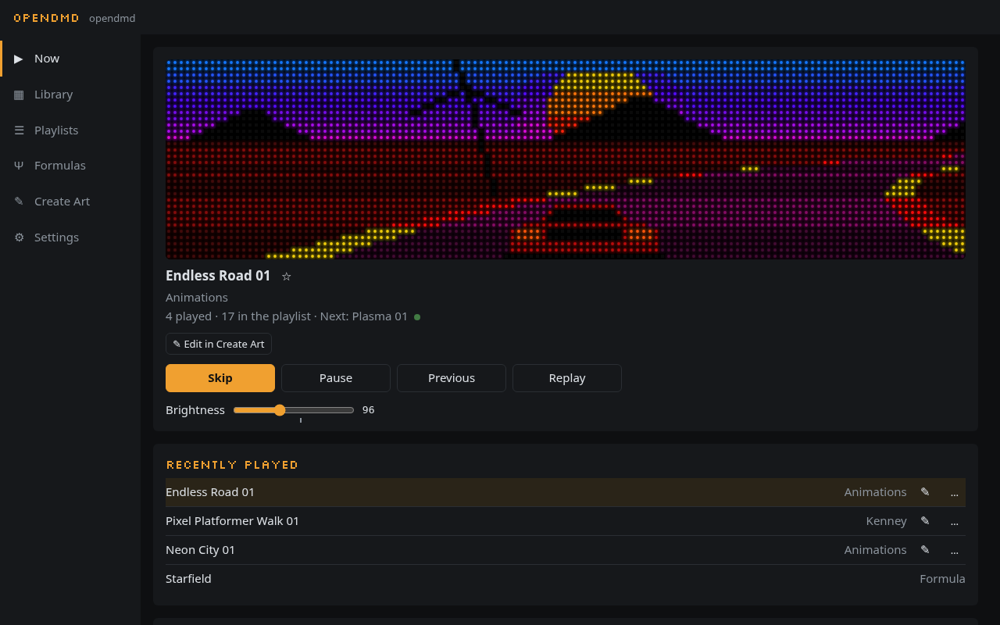
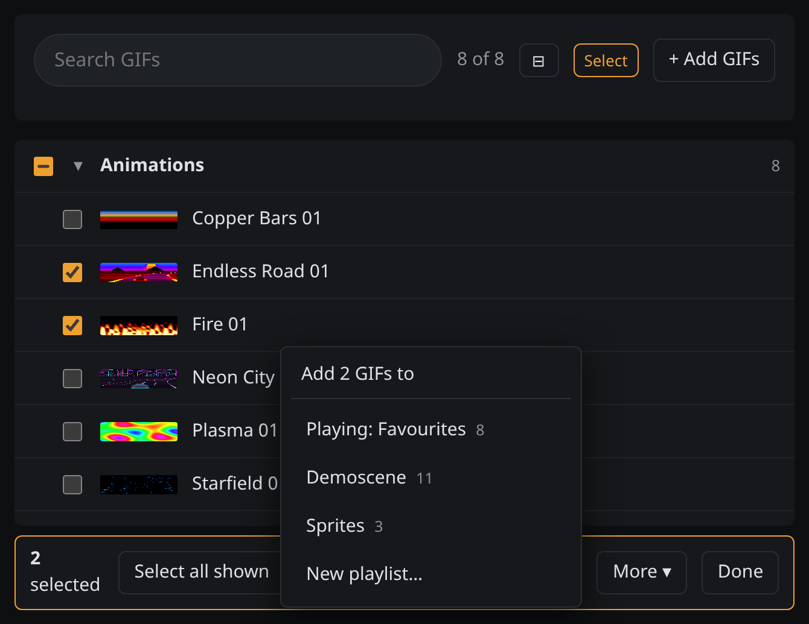
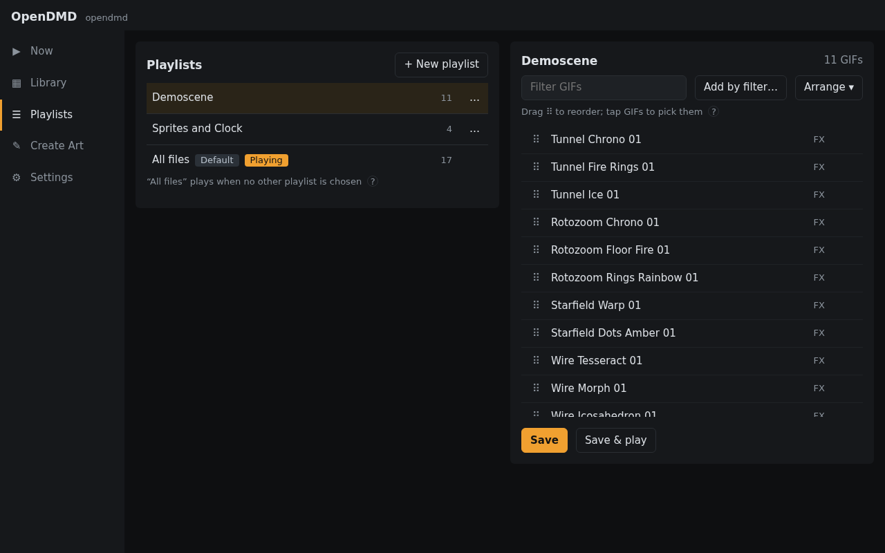
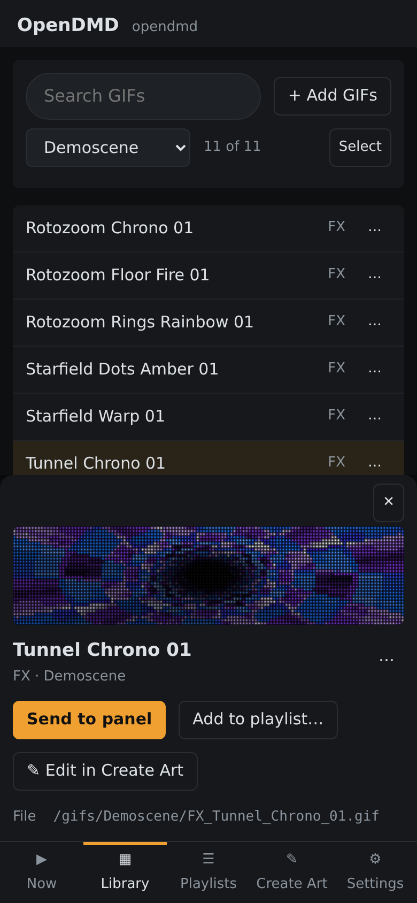

# The web app

You manage the display from a web page it serves itself. Open
**<http://opendmd.local/>** on any phone, tablet or computer on the same
WiFi; there is nothing to install.

The first time, open **Now** to see what's playing and try **Skip**, then
open **Playlists** to choose what plays.

On a computer the views are listed down the left side, and on a phone along
the bottom. They are **Now**, **Library**, **Playlists**, **Formulas**,
**Create Art** (**Create** on a small phone) and **Settings**.

The [demo](https://opendmd.dev/demo/) is the same app running in your
browser, with a few sample animations.

## Now

Now shows what the panel is playing: the title, its platform and category,
how many GIFs it has played since it started and how many the playlist
has, such as "14 played · 10,162 in the playlist" (with what comes next,
once the display has picked it), and a moving preview drawn
the way the LEDs look. Use it as a remote. **Skip** goes to the next GIF,
**Pause** and **Resume** stop and start it, and the slider sets the
brightness. To hide the preview, turn off **Mirror the panel on Now** in
Settings › Panel.

**Recently played**, under the preview, lists what the panel showed last,
even while no page was open. Tap one to play it again. **Replay** restarts
what is on now, and **Previous** steps back one at a time.

On a computer the keyboard works too: **Space** pauses and resumes, **→**
skips and **←** goes back, as Previous does.

**Preview look**, at the bottom, changes how this page draws the preview
(its glow and contrast), to match your panel better. It doesn't change the
panel.

Tap **☆** next to the title to make the GIF a favourite in the playlist
that's playing. It turns to **★**, and a second tap undoes it; the message
that pops up names the playlist. The **…** on a Recently played GIF has the
other choices: play less often, play longer. Formulas have no ☆.

When a schedule or night mode is in charge, Now says so, and **Wake for an
hour** brings the panel back for a while.

When there's nothing to play, Now says why instead. It can be no card, an
empty playlist, or a platform filter that matches none of the playlist's
GIFs, which comes with a **Clear filter** button.

## Library

The Library lists every GIF on your card by folder (Arcade, Consoles and so
on), each folder with how many GIFs it holds. Click a folder to open it and
again to close it; **⊟** closes them all. Each GIF has a small picture of
its first frame, and resting the pointer on one, or moving to it with the
keyboard, plays a moment of it. The chips at the top narrow the list by
platform.

**Search** looks through every GIF on the card. Only the folders with
matches stay, opened, each saying how many it has. The chips show the
platforms of the matches, such as **SNES 17**; tap one to narrow the
results and tap it again to undo. Clear the box to go back to the folders
as they were.

With a keyboard, ↑ and ↓ move, → opens a folder or steps into it, ← closes
it or steps back out, and Enter opens a folder or a GIF.

Click a GIF to open its details, with a preview and its title, platform,
category and author. From there:

- **Send to panel** plays it now; afterwards the playlist carries on.
- **Add to playlist…** puts it in one of your playlists: the one playing
  comes first, or start a new one.
- **Edit in Create Art** opens it in [Create Art](create-art.md) to
  change it.
- **Edit details…** changes its title, platform, category or author. The
  GIF is renamed on the card and every playlist keeps up.
- **Delete…** removes it from the card and from every playlist, after
  asking first.

### Several at once

Press **Select**, or long-press a GIF on a phone, and tick boxes appear. A
tap picks a GIF, and a folder's box picks every GIF in it, and **None**
unpicks them all. **Add 3 to playlist ▾** asks which of your playlists
they go in (the one playing first) or starts a new one; GIFs already in it
aren't added twice. **Done** leaves Select.

### Adding GIFs

Press **+ Add GIFs** and pick files from your computer or phone. For each
one, give it a title, a platform, a category (or a new one) and, if you
like, an author. The app suggests a title from the file name and shows the
name the GIF will get on the card. Afterwards it offers to add the new GIFs
to the playlist that's playing. Each GIF is made ready for smooth playback
as it uploads.

### Smooth motion

Some GIFs scroll or move in jumpy steps of a few pixels. When the app spots
one, a **Smooth motion** switch appears under its preview. Turn it on and
the web app fills in the in-between steps so it glides instead. Your GIF file
isn't changed, and you can switch it off again. A GIF with more than 256
colours doesn't get the switch.

## Playlists

A playlist is the set of GIFs the panel cycles through. **All files** is
the default and plays everything listed on your card; **Halloween** and
**Christmas** appear too if your card has those lists.

Tap a playlist to open it. On a computer it opens beside the list; on a
phone it takes the whole screen, and **‹ Playlists** goes back.

### Making a playlist

Press **+ New playlist** and give it a name. Then **+ Add GIFs** shows your
folders beside the playlist, or in its place on a phone, where **Done**
goes back. Fill it in any of these ways:

- Tick GIFs, or a whole folder, and press **Add 12 ticked**.
- Search for "mario", tap the **SNES** chip and press **Add all 41 shown**.
- Press **Add by filter…** to fill it by rules: platforms, categories and
  title words, shuffled or cut to a number if you like. **Leave out**
  drops logos, intros and the like.
- In the Library, open a GIF and choose **Add to playlist… › New
  playlist…**, or **Select** several and press **Add to playlist ▾ › New
  playlist…**.

A GIF already in the playlist has a ✓ and isn't added twice.

### Editing a playlist

Open it, and every GIF shows its first frame. Drag the ⠿ handles to
reorder, or use a GIF's **…** to move it up, down, to the top or to the
end. Press ✕ to remove one, or tap GIFs (or press **Select** for tick
boxes) and use **Arrange** to move or remove them, then **Save**. A
removal, Clear, Shuffle or a replace by filter can be undone from its
message. Leaving with changes not saved asks whether to save them. The playlists that come with your card (All
files, Halloween, Christmas) are saved under a name of your own.

**Save & play** while editing, or **Play** from a playlist's **…** menu,
switches the panel to it in a few seconds. The same menu has **Rename…**
and **Duplicate** (the new one is called "Consoles 2", say): favourites come
along, and a renamed playlist keeps playing and keeps its place in the
schedule.

### Favourites

Right-click a GIF in the Library or a playlist, or use its **…** button, to
tune how it plays in that playlist. On a phone, long-press it in a
playlist.

- **Favourite** plays it more often.
- **Play less often** does the opposite.
- **Play longer or loop…** keeps it on screen twice as long or for a
  number of seconds, or plays it a set number of times.

These are per playlist, so a GIF can be a favourite in one and play less
often in another. **Reset** puts it back to normal. To keep a GIF from
playing in a playlist, take it out of the playlist.

## Formulas

Formulas are a few lines of maths that draw on the panel. The view has
examples to remix, a live editor, the gallery and **Save as GIF…**. See
[Formulas](formulas.md), and [Make a Formula](psi-1.md) to write your own.

## Settings

Settings has five tabs. Changes save as you make them, and a green
**Saved ✓** says so.

### Playback

**Playlist** picks which playlist plays. **Platforms** says **All** with
how many there are, or the ones you picked. **Choose…** lists them with how
many GIFs each has, with the rare ones behind **+N more** and a box to find
one. Tap the ones you want and press **Only these**, or **All platforms**.

**Each GIF stays** sets the shortest and longest time a GIF is on (3 to
30 seconds unless you change them), and **Shuffle** mixes the order. **A Formula you
show on the panel stays** for one turn, 1 or 5 minutes, or until you change
it.

### Panel

**Brightness** sets how bright the panel is, and **Maximum brightness**
under it caps the slider. Going above the suggested level can make the
display reset on the power supply it came with, so only raise it if you've
fitted a stronger one.

**Colour** shows everything in full colour, or in a single colour like a
classic dot-matrix display: amber, red, green, blue or white. **Phosphor
glow** makes dots fade out softly like an old plasma display.

**Formula over every GIF** lays a Formula, such as scanlines or an old TV,
over everything the panel plays.

**Mirror the panel on Now** turns the preview on Now on or off, in this
browser only.

Under **Transition**, **Style** is how the panel moves from one GIF to the
next (dissolve, wipe, blinds, push, fade or none) and **Speed** is how fast;
**Preview** shows it.

Under **Start-up**, **Start-up** is what the panel shows while it starts:
**OpenDMD (built in)**, the name lighting up dot by dot, or one of your
Formulas or a bundled one in its place. Formulas too heavy for the start-up
show are listed but can't be picked. **Length** is how long the show runs
(**Off**, **Short** or **Full**); the first GIF comes after it, or once the
card is ready if that takes longer. While a Formula plays, the panel still
writes what you need to know over it: the network to join when the display
is new, a card problem, or its address. If the Formula can't play (deleted,
broken, or the display short of memory), the panel shows OpenDMD instead,
and Settings says why under the picker. **Preview** plays the show here,
and **No card screen** shows what the panel says without a card.

### Schedule

**Time** sets your time zone, for the clock and schedules.

**Location** is roughly where the panel is, so Formulas can follow the real
sun: daylight, dawn and dusk, the seasons. Type the latitude and longitude
from a map app, or press **Use this browser’s location**. Browsers only
share a location with secure https pages, so on the display's own page
you'll usually type them. **Clear** removes it. The location stays on the
display and is never written to the card or shared.

**Schedule** picks a playlist or brightness for certain days and times,
such as "weekday evenings: Consoles". The first rule that matches wins, and
your normal settings come back when it ends. A rule can also be for part of
the year: tick **Only from** and pick the first and last days, such as 1
October to 31 October. If your card has the Halloween or Christmas
playlist, **Add Halloween** and **Add Christmas** make that rule in one
press: the playlist all day from 1 to 31 October, or from 1 to 26
December. They go first, so they win over your other rules while they
last.

**Night mode** turns the panel off, or dims it, every night: between the
times you choose, or **from sunset to sunrise** where the panel is. That
needs the **Location** above, and follows the seasons by itself. Make it
30 minutes or an hour **shorter** (starting after sunset, ending before
sunrise) or **longer**. While it's on, Now says until when.

### RePlayOS

**Follow RePlayOS** links the display to a RePlayOS gaming box: when you
start a game the panel shows that game, and in the menus it plays the
**Attract playlist** of your choice. [Follow RePlayOS](replayos.md) has the
steps to set it up and what the panel does.

### Device

**Status** shows the playlist and how many GIFs it has, the card, and how
long the display has been running. **Reload playlist** reads the card again
if you changed it in a computer, and **Reboot** restarts the display.

**Card speed** is **Safe** unless you choose **Fast**, which reads the card
faster. Some cards return wrong data at Fast without an error, so choose
Safe again if GIFs look damaged.

**Ready to play** shows how many GIFs have been prepared for their
smoothest playback. The display does this by itself while it is dark at
night or paused; **Prepare remaining files** does the rest now, from your
browser. **Thumbnails in the Library and playlists** turns the small
pictures on or off. Your browser keeps each one, so the display sends it only
once.

**Network** changes the WiFi network or the **Display name** (`opendmd` in
`opendmd.local`); press **Save network** to keep the change. A WiFi change
needs a reboot, and a new name works straight away. Give each display its
own name if you have more than one; [Troubleshooting](troubleshooting.md#two-displays-with-the-same-name)
says what happens when two share one. **Work or school
login** is here too, as on the setup page.

**Moving pictures** has two switches for GIFs that move fast. **Sync to the
panel’s refresh** stops tearing, and **Delay the bottom half one refresh**
takes away the step at mid-height on fast scrollers.

**Panel timing** is for a panel that shows a few wrong-coloured dots on
some pictures. **Test panel timing** shows test pictures under A and B and
saves the one you pick. A change by hand is tried for a minute and undone
unless you press **Keep**; [Troubleshooting](troubleshooting.md#some-leds-show-the-wrong-colours-on-certain-pictures)
has the steps.

**Firmware** shows the version and installs updates; see
[Updating](updating.md).

**Security** has **Require a key for the API**. Without a key, anyone on
your WiFi can change the panel, so the web app shows a banner offering to
set one until you do; the setup page offers one too. Each browser asks for
the key once. The key is the only lock, and it travels in clear text on
your network, so keep the display on a network you trust.

**About** shows the display's address, the firmware and web app versions,
an **API reference** link to the HTTP API for scripts, and the
**Open-source licences**. If another display already has its name, About
says so.

## On a phone

The web app works the same on a phone. The details of a GIF slide up from
the bottom, and a playlist opens as a screen of its own, where **+ Add
GIFs** takes the whole screen until **Done**. Long-press replaces
right-click; in the Library, long-press starts Select.
