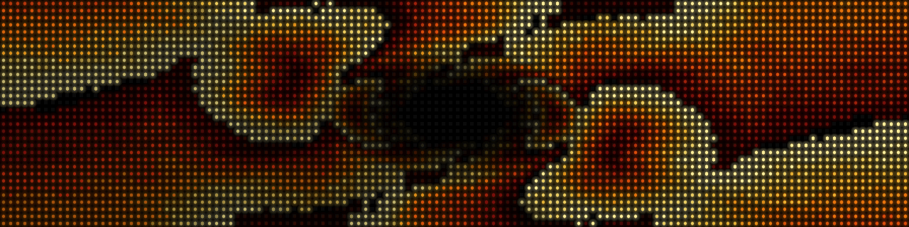
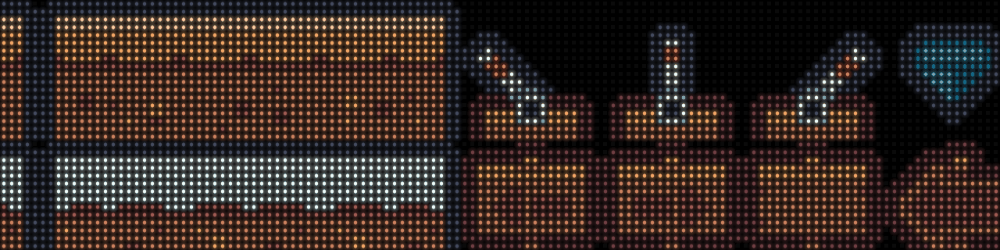

# The simulator

`opendmd-sim` plays a card, or any folder of GIFs, in a desktop window drawn
as the panel's LEDs: the same `opendmd-core` engine the firmware runs, with
a renderer that models the real P4 panel's dots and glow instead of flat
squares. It is a tool for developers, for checking a Formula, a transition
or a card without a board on the desk.

Most people want the [web demo](https://opendmd.dev/demo/) instead. It runs
in any browser with nothing to install, and plays a demo card on the same
engine.



## Run it from source

You need a stable [Rust toolchain](https://rustup.rs/) and a desktop to
open the window on. From a checkout:

```bash
make sim                                  # a folder picker opens
make sim ARGS="/path/to/card"             # a card: a folder with filelist.txt
make sim ARGS="/path/to/gifs"             # any folder of GIFs, in name order
make sim ARGS="/path/to/one.gif"          # a single GIF
make sim ARGS="--demo"                    # the built-in demo, no files needed
```

(`cd opendmd-sim && cargo run --release -- <options>` does the same.) With
no argument a folder picker opens, and the demo plays if you cancel it. A
folder or GIF dropped onto the program counts as the argument.
`opendmd-sim --help` lists every option. The ones used most:

- `--platforms`, `--title` and `--category` filter a card, and `--shuffle`
  mixes it.
- `--scale` is pixels per LED, 10 by default.
- `--transition`, `--look` (the panel's tints) and `--glow` set how it
  plays.
- `--formula FILE.psi` plays a Formula, with `--formula-opts a=0.5&fps=100`
  for its settings. `opendmd-psi/formulas/` has `plasma.psi`, `fire.psi`
  and others, and the `psi` feature is on by default.
- `--play` plays one virtual file: `'@card:Title|Subtitle'`,
  `'@boot?len=full'`, or `'@formula?psb=…'` for a compiled Formula from
  `psi build FILE.psi --base64`.

| Key | |
|---|---|
| `Space` | next GIF |
| `P` | pause / resume |
| `L` | LED or flat squares |
| `Esc` | quit |

The demo and the web demo's card use only OpenDMD's own Formulas and
[Kenney](https://kenney.nl/assets/pixel-platformer) sprites (CC0).

## Screenshots without a window

`--screenshot out.png` renders one frame and exits, so it works on a
headless machine; `--screenshot-at <ms>` picks the moment, and
`--screenshot-canvas out.png` writes the raw 128x32 canvas. This is how the
pictures on this page were made:

```bash
make sim ARGS="--demo --screenshot demo.png --screenshot-at 500"
make sim ARGS="--play '@boot?len=full' --screenshot boot.png"
```



How the LEDs are drawn (their size, bloom and gamma) is modelled in
`opendmd-render/src/lib.rs`, measured from a close-up photo of the real panel.
